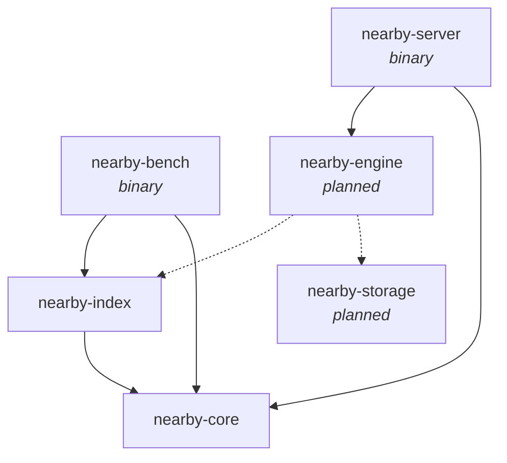

<div align="center">

# Nearby

**A vector database in Rust, built from first principles.**

Exact and approximate nearest-neighbor search, SIMD distance kernels, and a
benchmark harness that keeps every optimization honest.

[](#license)
[](rust-toolchain.toml)
[](#roadmap)

</div>

---

## Highlights

- **Exact and approximate search behind one trait.** `FlatIndex` is always
  correct; `Hnsw` answers about 30× faster at 99% recall on 200k vectors
  ([synthetic data](#performance)).
  Both implement `VectorIndex`, so either can be used anywhere.
- **L2, cosine and dot product**, all expressed as distances (lower is
  closer), so heaps and indexes never care which metric is in use.
- **SIMD where it counts.** AVX2 + FMA kernels are picked at runtime on
  x86-64, about 2× faster than portable code, with a portable fallback that
  the compiler vectorizes (NEON on aarch64).
- **Memory-aware HNSW.** Neighbor vectors are prefetched before they are
  measured, visited sets are pooled and reset in O(1), and searches take
  `&self`, so many threads can query one index at once.
- **Parallel, deterministic builds.** `insert_batch` links vectors on every
  core (3.6× faster on SIFT1M with 16 threads) and builds the same graph
  whatever the thread count.
- **Reproducible by design.** Seeded graph construction, deterministic tie
  breaking, and identical results across runs on a given machine.
- **Measured, not guessed.** Every optimization in the history comes with
  before/after numbers, and ideas that didn't pay off were measured and left
  out.

## Quick start

Nearby isn't on crates.io yet. Depend on the crates by path (or git):

```toml
[dependencies]
nearby-core = { path = "../nearby/crates/core" }
nearby-index = { path = "../nearby/crates/index" }
```

```rust
use nearby_core::Metric;
use nearby_index::{FlatIndex, Hnsw, HnswParams, VectorIndex};

fn main() -> nearby_core::Result<()> {
    // Approximate search: fast on large data, recall tuned with ef_search.
    let mut hnsw = Hnsw::new(3, Metric::Cosine, HnswParams::default())?;
    // Exact search: the ground truth to measure HNSW against.
    let mut flat = FlatIndex::new(3, Metric::Cosine);

    for (id, vector) in [(1, [1.0, 0.0, 0.0]), (2, [0.0, 1.0, 0.0]), (3, [0.9, 0.1, 0.0])] {
        hnsw.insert(id, &vector)?;
        flat.add(id, &vector)?;
    }

    hnsw.set_ef_search(100); // higher: better recall, slower searches
    let query = [1.0, 0.05, 0.0];
    for index in [&hnsw as &dyn VectorIndex, &flat] {
        for hit in index.search(&query, 2)? {
            println!("id {} at distance {:.4}", hit.id, hit.distance);
        }
    }
    Ok(())
}
```

```text
id 1 at distance 0.0012
id 3 at distance 0.0018
id 1 at distance 0.0012
id 3 at distance 0.0018
```

Vectors are validated on the way in: a wrong dimension or a NaN returns an
`Error` instead of corrupting the index.

## Performance

200,000 clustered 128-d vectors, 200 queries, k = 10, one thread, on an Intel
Tiger Lake laptop (`cargo run -p nearby-bench --release`, default target):

| Index | Recall@10 | Mean latency | Queries/s |
|---|---:|---:|---:|
| `FlatIndex` (exact) | 1.0000 | 5.43 ms | 184 |
| `Hnsw`, `ef_search = 40` | 0.8325 | 72 µs | 13,866 |
| `Hnsw`, `ef_search = 160` | 0.9920 | 181 µs | 5,527 |
| `Hnsw`, `ef_search = 320` | 0.9945 | 266 µs | 3,760 |

Building the HNSW index (`m = 16`, `ef_construction = 200`) one vector at a
time takes 25 s.

On SIFT1M (1M real 128-d descriptors, same machine and parameters),
`insert_batch` cuts the build from 367 s to 101 s with 16 threads, at the
same recall (0.9932 at `ef_search = 160`).

> [!NOTE]
> These are synthetic vectors, so treat them as indicative. Recall depends
> heavily on the data: real descriptors such as SIFT are clustered and do
> well, while uniformly random high-dimensional vectors are a worst case.
> Run the [benchmark](#benchmark) on SIFT or GIST for numbers that matter.

## How it works

The workspace is split into small crates with one job each. Dependencies only
point toward `nearby-core`.



| Crate | Responsibility |
|---|---|
| `nearby-core` | Shared types (`PointId`, `Metric`, `ScoredPoint`), the error type, distance kernels and the `TopK` collector. |
| `nearby-index` | The `VectorIndex` trait, `FlatIndex` and `Hnsw`. |
| `nearby-engine` | *Planned.* Collections, the id map and query execution. |
| `nearby-storage` | *Planned.* Segments, the write-ahead log and recovery. |
| `nearby-server` | Configuration and logging. The network API is not implemented yet. |
| `nearby-bench` | Recall, throughput and latency benchmark on TEXMEX datasets. |

<details>
<summary><b>Design rules</b></summary>

- **Every metric is a distance: lower is closer.** `L2` is squared Euclidean
  distance, `Cosine` is `1 - cosine_similarity`, and `Dot` is the negated dot
  product.
- **Validate at the boundary, trust inside.** `validate_vector` rejects wrong
  dimensions and NaN/infinite values when data enters an index. Hot paths
  only `debug_assert!` their inputs.
- **Results are deterministic.** Candidates at equal distance are ordered by
  ascending id.
- **Libraries return `nearby_core::Error`; binaries use `anyhow`.** Callers
  can `match` on specific error variants.
- **Only binaries configure logging.** Library crates just emit `tracing`
  events.
- **`unsafe` is rare and justified.** It appears only for SIMD intrinsics and
  prefetching, each block with a `SAFETY` comment.

</details>

<details>
<summary><b>Exact search: <code>FlatIndex</code></b></summary>

`FlatIndex` compares the query with every stored vector: O(N · dim) per query,
always correct.

- Vectors are stored back to back in one contiguous `Vec<f32>`, so a scan
  reads memory sequentially.
- The best `k` candidates are kept in `TopK`, a max-heap of size `k`. Once it
  is full, rejecting a candidate costs one comparison: O(N log k) instead of
  O(N log N) for a full sort.
- With `Metric::Cosine`, each vector's norm is stored at insert time, so a
  comparison costs one dot product instead of three.

</details>

<details>
<summary><b>Approximate search: <code>Hnsw</code></b></summary>

`Hnsw` implements Hierarchical Navigable Small World graphs (Malkov &
Yashunin, 2016). Every vector is a node linked to its nearest neighbors on
layer 0; a random few also live on higher, sparser layers that act as express
lanes. A search starts at the top, moves greedily toward the query, drops a
layer whenever it can't get closer, and finishes with a wider search on layer
0: roughly O(log N) distance computations instead of O(N).

- **Layout.** Each vector gets a dense `u32` node id. Layer-0 links live in
  one flat array with `m0` slots per node; the sparse upper layers use
  per-node lists.
- **Prefetching.** Large indexes are bound by memory latency, not arithmetic.
  Before measuring a node's neighbors, the search starts loading every
  unvisited neighbor's vector, so the loads overlap (1.5–1.7× faster
  searches).
- **Neighbor selection** uses the paper's heuristic (Algorithm 4): a
  candidate is dropped if a neighbor already chosen is strictly closer to it
  than the new node is, which spreads links across directions. Ties are kept,
  as in hnswlib.
- **Cosine costs one dot product** per comparison, thanks to stored norms.
- **Allocation-free visited sets.** Searches borrow a set from a pool, and a
  generation counter clears it in O(1).
- **Reproducible builds.** Layers come from a seeded `SplitMix64`.
- **Parallel builds.** `insert_batch` links vectors in chunks of up to 256.
  Every vector in a chunk searches the graph as it was before the chunk, all
  in parallel, and is compared directly with the chunk's earlier vectors,
  which that graph can't reach yet. Back-link pruning is independent per
  neighbor list, so it runs in parallel too. Chunk sizes depend only on the
  graph size, so the graph is the same for any thread count (though not the
  one inserting vectors one at a time builds), and recall matches.

| Parameter | Default | Effect |
|---|---|---|
| `m` | 16 | Links per node on upper layers. More: better recall, more memory, slower inserts. |
| `m0` | 32 | Links per node on layer 0, usually `2 * m`. At most 1024. |
| `ef_construction` | 200 | Candidates considered per insert. Higher builds a better graph, more slowly. |
| `ef_search` | 64 | The recall/speed dial at query time. Change it any time with `set_ef_search`; a search always uses at least its `k`. |
| `seed` | `0x5EED` | Seed for layer assignment. |

> [!WARNING]
> Many *identical* vectors degrade reachability: they tie at distance 0, link
> to the same few nodes, and later copies lose their incoming links when
> those lists are pruned. This is inherent to HNSW (hnswlib behaves the same
> way). Deduplicate before indexing.

</details>

<details>
<summary><b>Distance kernels</b></summary>

`dot` and `l2_squared`, and everything built on them, pick a kernel at
runtime:

| CPU | Kernel |
|---|---|
| x86-64 with AVX2 + FMA (Intel since 2013, AMD since 2015) | Hand-written SIMD: 4 accumulators × 8 lanes, about 2× faster than portable |
| Anything else | Portable code with 8 independent running sums, which the compiler vectorizes (NEON on aarch64) |

The default x86-64 target only guarantees SSE2, so the CPU is checked once at
runtime instead of requiring a CPU-specific build. The kernels round
differently, so distances can differ in the last bits between CPUs; on any one
machine they are deterministic.

</details>

## Benchmark

`nearby-bench` builds a flat index, an HNSW index or both, runs every query,
and reports recall against the dataset's ground truth plus throughput and
latency. For HNSW it sweeps several `ef_search` values, so one run shows the
whole recall/speed trade-off.

### Get a dataset

The bench reads the [TEXMEX](http://corpus-texmex.irisa.fr/) `.fvecs` /
`.ivecs` formats. Extract the archives into `data/`, which is git-ignored:

```sh
mkdir -p data && cd data
curl -O ftp://ftp.irisa.fr/local/texmex/corpus/siftsmall.tar.gz
tar -xzf siftsmall.tar.gz
```

| Dataset | Archive | Base vectors | Queries | Dimension | Base file |
|---|---|---:|---:|---:|---:|
| SIFT10K | `siftsmall.tar.gz` | 10,000 | 100 | 128 | 5 MB |
| SIFT1M | `sift.tar.gz` | 1,000,000 | 10,000 | 128 | 516 MB |
| GIST1M | `gist.tar.gz` | 1,000,000 | 1,000 | 960 | 3.8 GB |

A dataset directory `<name>/` must contain `<name>_base.fvecs`,
`<name>_query.fvecs` and `<name>_groundtruth.ivecs`. The TEXMEX archives
already extract in that layout.

### Run it

```sh
cargo run -p nearby-bench --release -- [DATASET_DIR] [OPTIONS]

# Examples
cargo run -p nearby-bench --release -- data/sift --k 100 --ef 100,200,400
cargo run -p nearby-bench --release -- data/gist --index hnsw --m 32
```

| Option | Default | Meaning |
|---|---|---|
| `DATASET_DIR` | `data/siftsmall` | Dataset directory. |
| `--index flat\|hnsw\|both` | `both` | Which indexes to build and query. |
| `--k N` | `10` | Neighbors per query. At most the ground truth's width (100 for TEXMEX). |
| `--m N` | `16` | HNSW links per node (`m0` is set to `2 * m`). |
| `--ef-construction N` | `200` | HNSW candidates per insert. |
| `--threads N` | all available | Threads that build the HNSW index (`insert_batch`). The graph is the same for any value. |
| `--ef N,N,...` | `10,20,40,80,160,320` | HNSW `ef_search` values, one result row each. Values below `k` run as `k`, and each row is labeled with the `ef` it actually used. |
| `-h`, `--help` | | Print usage. |

> [!TIP]
> Always use `--release`: debug builds are many times slower. Compiling for
> your exact CPU (`RUSTFLAGS="-C target-cpu=native"`) adds 5–25% on
> cache-resident distances and ~5% when memory-bound, but the binary may not
> run on other machines.

<details>
<summary><b>Reading the output</b></summary>

```text
dataset  siftsmall: 10000 base vectors, 100 queries, dim 128

build    flat: ...
build    hnsw (m=16, ef_construction=200, threads=16): ..., ... layers

index          recall@10       qps       mean        p50        p95        p99        max
flat              1.0000       ...        ...        ...        ...        ...        ...
hnsw ef=10           ...       ...        ...        ...        ...        ...        ...
...
```

- **build**: time to insert every base vector. For HNSW that's graph
  construction; the line also reports the number of layers.
- **recall@k**: the average fraction of each query's true `k` nearest
  neighbors found among the first `k` results. The flat index is exact, so
  anything below 1.0000 there is a bug.
- **qps**: queries per second, run one after another on a single thread.
- **mean … max**: per-query latency, with nearest-rank percentiles. Tail
  latencies (p95, p99) are what the slowest requests experience.

The base file is streamed from disk each time an index is built, and each
index is dropped before the next is built, so peak memory is about that of
the largest single index.

</details>

## Server

```sh
cargo run -p nearby-server -- [path/to/nearby.toml]
```

The config path defaults to `nearby.toml`. A missing file means all defaults;
unknown keys are rejected, and an invalid `RUST_LOG` stops startup with an
error rather than being ignored.

<details>
<summary><b>Every configuration key and its default</b></summary>

```toml
data_dir = "./data"

[log]
level = "info"            # tracing filter directive; RUST_LOG overrides it
console = true
console_format = "full"   # "full", "compact" or "json"
file = true               # JSON lines in rolling files
file_dir = "./logs"
file_prefix = "nearby"
rotation = "daily"        # "minutely", "hourly", "daily" or "never"
max_files = 14            # 0 keeps every file
```

</details>

## Development

Nearby builds on stable Rust (2024 edition; see `rust-toolchain.toml`).

```sh
cargo test --workspace                                  # unit, integration and doc tests
cargo clippy --workspace --all-targets -- -D warnings   # pedantic lints, warnings are errors
cargo fmt --all --check
RUSTDOCFLAGS="-D warnings" cargo doc --workspace --no-deps
```

- **Lints** are configured once in `[workspace.lints]`: clippy's `pedantic`
  group, and `missing_docs`, so every public item is documented.
- **Tests:** unit tests live next to the code in `#[cfg(test)] mod tests`.
  Public-API tests live in `crates/<crate>/tests/`, where they compile as a
  separate crate, exactly as a downstream user sees the API. SIMD tests run
  every kernel the CPU supports, not just the one in use.
- **Commits** follow [Conventional Commits](https://www.conventionalcommits.org/)
  (`feat`, `fix`, `perf`, `test`, `docs`, ...). Each one builds and passes
  the full suite on its own, and `perf` commits record their measurements.

## Roadmap

- [x] Exact search (`FlatIndex`)
- [x] HNSW approximate search
- [x] SIMD distance kernels (AVX2 + FMA, runtime dispatch)
- [x] Benchmark harness with recall, latency percentiles and `ef` sweeps
- [x] Parallel HNSW construction
- [ ] Product quantization
- [ ] Engine: collections, id map, deduplication and deletes
- [ ] Storage: segments, write-ahead log and recovery
- [ ] Server network API

## License

Dual-licensed under [MIT](https://opensource.org/licenses/MIT) or
[Apache-2.0](https://www.apache.org/licenses/LICENSE-2.0), at your option.
