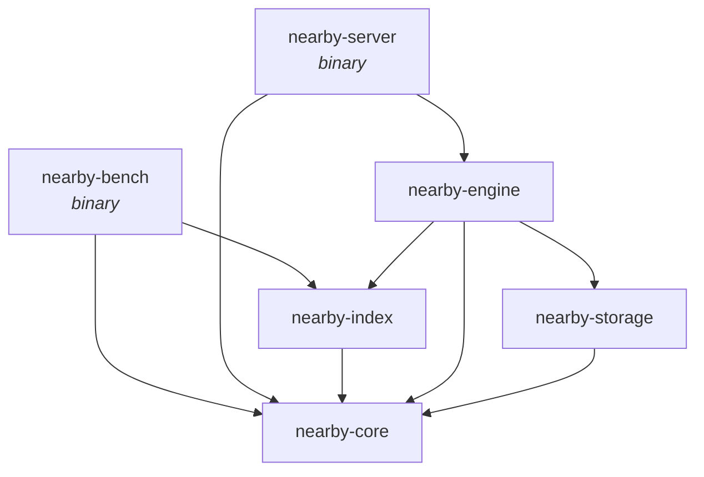

<div align="center">

# Nearby

**A vector database in Rust, built from first principles.**

Exact, graph and compressed nearest-neighbor search, a crash-safe storage
engine, an HTTP API, and a benchmark harness that keeps every optimization
honest.

[](#license)
[](rust-toolchain.toml)
[](#roadmap)

</div>

---

## Highlights

- **A complete database.** Named collections with upserts, deletes and
  search over an HTTP + JSON API, kept durable by a checksummed write-ahead
  log and immutable segments, and recovered exactly after a crash.
- **Exact and approximate search behind one trait.** `FlatIndex` is always
  correct; `Hnsw` answers about 30× faster at 99% recall on 200k vectors
  ([synthetic data](#performance)).
  Both implement `VectorIndex`, so either can be used anywhere.
- **L2, cosine and dot product**, all expressed as distances (lower is
  closer), so heaps and indexes never care which metric is in use.
- **SIMD where it counts.** AVX2 + FMA kernels are picked at runtime on
  x86-64, about 2× faster than portable code, with a portable fallback that
  the compiler vectorizes (NEON on aarch64).
- **Memory-aware HNSW.** Neighbor vectors are prefetched before they are
  measured, visited sets are pooled and reset in O(1), and searches take
  `&self`, so many threads can query one index at once.
- **Parallel, deterministic builds.** `insert_batch` links vectors on every
  core (3.6× faster on SIFT1M with 16 threads) and builds the same graph
  whatever the thread count.
- **Compressed vectors.** `PqIndex` stores each 128-d vector in 16 bytes
  (32× smaller) with product quantization, searched through per-query lookup
  tables.
- **Reproducible by design.** Seeded graph construction, deterministic tie
  breaking, and identical results across runs on a given machine.
- **Measured, not guessed.** Every optimization in the history comes with
  before/after numbers, and ideas that didn't pay off were measured and left
  out.

## Quick start

Run the server (it stores data in `./data` and listens on `127.0.0.1:7700`):

```sh
cargo run -p nearby-server --release
```

Then create a collection, add points and search:

```sh
curl -X PUT localhost:7700/collections/docs -H 'content-type: application/json' \
  -d '{"dim": 3, "metric": "cosine", "index": {"type": "hnsw"}}'

curl -X PUT localhost:7700/collections/docs/points -H 'content-type: application/json' \
  -d '{"points": [{"id": 1, "vector": [1, 0, 0]}, {"id": 2, "vector": [0, 1, 0]},
                  {"id": 3, "vector": [0.9, 0.1, 0]}]}'

curl -X POST localhost:7700/collections/docs/search -H 'content-type: application/json' \
  -d '{"vector": [1, 0.05, 0], "k": 2}'
# {"results":[{"id":1,"distance":0.0012476444},{"id":3,"distance":0.0018416047}]}
```

The indexes can also be used directly as a library. Nearby isn't on crates.io
yet, so depend on the crates by path (or git):

```toml
[dependencies]
nearby-core = { path = "../nearby/crates/core" }
nearby-index = { path = "../nearby/crates/index" }
```

```rust
use nearby_core::Metric;
use nearby_index::{FlatIndex, Hnsw, HnswParams, VectorIndex};

fn main() -> nearby_core::Result<()> {
    // Approximate search: fast on large data, recall tuned with ef_search.
    let mut hnsw = Hnsw::new(3, Metric::Cosine, HnswParams::default())?;
    // Exact search: the ground truth to measure HNSW against.
    let mut flat = FlatIndex::new(3, Metric::Cosine);

    for (id, vector) in [(1, [1.0, 0.0, 0.0]), (2, [0.0, 1.0, 0.0]), (3, [0.9, 0.1, 0.0])] {
        hnsw.insert(id, &vector)?;
        flat.add(id, &vector)?;
    }

    hnsw.set_ef_search(100); // higher: better recall, slower searches
    let query = [1.0, 0.05, 0.0];
    for index in [&hnsw as &dyn VectorIndex, &flat] {
        for hit in index.search(&query, 2)? {
            println!("id {} at distance {:.4}", hit.id, hit.distance);
        }
    }
    Ok(())
}
```

```text
id 1 at distance 0.0012
id 3 at distance 0.0018
id 1 at distance 0.0012
id 3 at distance 0.0018
```

Vectors are validated on the way in: a wrong dimension or a NaN returns an
`Error` instead of corrupting the index.

## Performance

200,000 clustered 128-d vectors, 200 queries, k = 10, one thread, on an Intel
Tiger Lake laptop (`cargo run -p nearby-bench --release`, default target):

| Index | Recall@10 | Mean latency | Queries/s |
|---|---:|---:|---:|
| `FlatIndex` (exact) | 1.0000 | 5.43 ms | 184 |
| `Hnsw`, `ef_search = 40` | 0.8325 | 72 µs | 13,866 |
| `Hnsw`, `ef_search = 160` | 0.9920 | 181 µs | 5,527 |
| `Hnsw`, `ef_search = 320` | 0.9945 | 266 µs | 3,760 |

Building the HNSW index (`m = 16`, `ef_construction = 200`) one vector at a
time takes 25 s.

On SIFT1M (1M real 128-d descriptors, same machine and parameters),
`insert_batch` cuts the build from 367 s to 101 s with 16 threads, at the
same recall (0.9932 at `ef_search = 160`).

> [!NOTE]
> These are synthetic vectors, so treat them as indicative. Recall depends
> heavily on the data: real descriptors such as SIFT are clustered and do
> well, while uniformly random high-dimensional vectors are a worst case.
> Run the [benchmark](#benchmark) on SIFT or GIST for numbers that matter.

## How it works

The workspace is split into small crates with one job each. Dependencies only
point toward `nearby-core`.



| Crate | Responsibility |
|---|---|
| `nearby-core` | Shared types (`PointId`, `Metric`, `ScoredPoint`), the error type, distance kernels and the `TopK` collector. |
| `nearby-index` | The `VectorIndex` trait, `FlatIndex`, `Hnsw` and `PqIndex` (product quantization). |
| `nearby-engine` | Collections, the id map, deletes and query execution, on top of indexes and storage. |
| `nearby-storage` | The write-ahead log, segments, compaction and recovery. |
| `nearby-server` | The HTTP + JSON API, configuration and logging. |
| `nearby-bench` | Recall, throughput and latency benchmark on TEXMEX datasets. |

<details>
<summary><b>Storage: <code>nearby-storage</code></b></summary>

Each collection lives in its own directory, managed by a `CollectionStore`:

```text
data/collections/docs/
├── collection.toml   dimension, metric and index settings
├── index.snapshot    HNSW or PQ index and id map, saved on shutdown (a cache)
├── vectors-*.spill   a PQ collection's full vectors, memory-mapped (scratch)
├── MANIFEST          which log and segments are live
├── wal-000007.log    writes since the last flush
├── seg-000004.seg    immutable batches of net changes, oldest first
└── seg-000006.seg
```

- **Write-ahead log.** Every write is appended as a CRC-32 checksummed record
  and, with `durability = "sync"`, synced before it is acknowledged. A batch
  upsert is one record batch and one sync.
- **Segments.** Once the log holds `flush_after_ops` writes, its net changes
  (the last write per id wins) become an immutable segment and a new log
  starts. When there are more than `max_segments`, they are compacted into
  one segment of live points. Compaction streams a k-way merge through the
  segments in id order, so its memory doesn't grow with the collection: 15 MB
  to compact 1M 128-d points (it was 1.1 GB when segments were loaded whole).
  Segments with payloads use format version 2; version 1 files still load.
- **Atomic switches.** New files are fully written and synced before a new
  `MANIFEST` is atomically renamed into place, so a crash at any moment
  leaves either the old set of files or the new one. Leftovers are deleted
  on the next open.
- **Recovery** replays the segments oldest first, then the log. A record cut
  short by a crash fails its length or checksum check and is truncated away;
  everything acknowledged before it is kept.

</details>

<details>
<summary><b>Collections: <code>nearby-engine</code></b></summary>

A `Database` holds named collections, each with a fixed dimension, metric and
index (`flat`, `hnsw` or `pq`, with its parameters).

- **Ids** are chosen by the caller. Writing an existing id replaces the point.
- **Deletes and replacements.** Indexes only append, so an old vector stays
  in the index, marked dead, and searches skip it with
  `VectorIndex::search_filtered`. HNSW still walks through dead nodes to
  reach live ones, so recall holds. Once dead vectors outnumber live ones,
  the index is rebuilt without them.
- **Restarts.** On shutdown, each HNSW and PQ collection saves a snapshot of
  its index and id map, tagged with the storage generation it matches. On start,
  a matching snapshot is loaded and only the log written since is replayed;
  otherwise (a crash after a flush, a damaged file) the index is rebuilt
  from storage. On SIFT1M, a restart takes 1.8 s instead of 87 s (the
  snapshot is 591 MB and takes 1.7 s to write). A PQ collection's snapshot
  holds its quantizer, codes and full vectors: 2.6 s instead of 8.5 s to
  retrain (545 MB, 3.1 s to write). Flat collections rebuild faster than a
  snapshot would load, so they don't save one.
- **PQ collections.** A quantizer needs data to train on, so a `pq`
  collection searches exactly until `training_points` points (default
  10,000) have been written, then trains on them and encodes every point.
  The codes are grouped into `lists` clusters (default 256; 0 turns this
  off), and each search scans the `probe` clusters nearest the query
  (default 16) for `rerank * k` candidates (default `rerank = 10`), then
  returns the best `k` by exact distance, reading the candidates' full
  vectors from a memory-mapped scratch file. On SIFT1M with 16 subspaces,
  scanning every code (`lists = 0`):

  | `rerank` | recall@10 |
  |---|---|
  | 1 (codes only) | 0.5310 |
  | 5 | 0.8984 |
  | 10 (default) | 0.9654 |
  | 20 | 0.9906 |
  | 50 | 0.9984 |

  Those searches take about 10 ms whatever `rerank` is, since scanning a
  million codes dominates. Clusters cut that down (`rerank = 10`):

  | `lists` / `probe` | recall@10 | Mean latency |
  |---|---|---|
  | 0 (scan every code) | 0.9654 | 9.7 ms |
  | 256 / 8 | 0.9036 | 0.49 ms |
  | **256 / 16 (default)** | **0.9500** | **0.80 ms** |
  | 256 / 32 | 0.9636 | 1.43 ms |
  | 1024 / 64, 50,000 training points | 0.9673 | 0.82 ms |

  Loading the million points takes 18 s (HNSW: 90 s). HNSW still searches
  faster at higher recall; PQ is for when build time or memory matters more.
- **Memory.** Each vector is held once: by the index for flat and HNSW
  collections, and for PQ in the scratch file, which the OS caches as
  memory allows, so only the 16-byte codes stay in the process. With SIFT1M
  loaded, the server process holds 856 MB for HNSW (was 1,370 MB, before
  vectors stopped being kept twice) and 80 MB for PQ (was 591 MB).
- **Payloads and filters.** A point's payload lives in the id map and is
  stored with its vector in the log, segments and snapshots. A filter is
  checked as each candidate is reached, so the index keeps searching until
  it finds `k` matches. HNSW walks through rejected points to reach matching
  ones: recall stays high, but the more a filter rejects, the more of the
  graph a search visits. SIFT1M, HNSW defaults, 200 queries:

  | Filter keeps | recall@10 | Mean latency |
  |---|---|---|
  | every point (no filter) | 0.9700 | 0.31 ms |
  | 10% | 0.9985 | 4.4 ms |
  | 1% | 1.0000 | 33.7 ms |

  At 1% a search costs about as much as an exact scan.
- **Concurrency.** Each collection has its own read-write lock: searches run
  alongside each other, and writes to one collection don't block others.

</details>

<details>
<summary><b>Design rules</b></summary>

- **Every metric is a distance: lower is closer.** `L2` is squared Euclidean
  distance, `Cosine` is `1 - cosine_similarity`, and `Dot` is the negated dot
  product.
- **Validate at the boundary, trust inside.** `validate_vector` rejects wrong
  dimensions and NaN/infinite values when data enters an index. Hot paths
  only `debug_assert!` their inputs.
- **Results are deterministic.** Candidates at equal distance are ordered by
  ascending id.
- **Libraries return `nearby_core::Error`; binaries use `anyhow`.** Callers
  can `match` on specific error variants.
- **Only binaries configure logging.** Library crates just emit `tracing`
  events.
- **`unsafe` is rare and justified.** It appears only for SIMD intrinsics and
  prefetching, each block with a `SAFETY` comment.

</details>

<details>
<summary><b>Exact search: <code>FlatIndex</code></b></summary>

`FlatIndex` compares the query with every stored vector: O(N · dim) per query,
always correct.

- Vectors are stored back to back in one contiguous `Vec<f32>`, so a scan
  reads memory sequentially.
- The best `k` candidates are kept in `TopK`, a max-heap of size `k`. Once it
  is full, rejecting a candidate costs one comparison: O(N log k) instead of
  O(N log N) for a full sort.
- With `Metric::Cosine`, each vector's norm is stored at insert time, so a
  comparison costs one dot product instead of three.

</details>

<details>
<summary><b>Approximate search: <code>Hnsw</code></b></summary>

`Hnsw` implements Hierarchical Navigable Small World graphs (Malkov &
Yashunin, 2016). Every vector is a node linked to its nearest neighbors on
layer 0; a random few also live on higher, sparser layers that act as express
lanes. A search starts at the top, moves greedily toward the query, drops a
layer whenever it can't get closer, and finishes with a wider search on layer
0: roughly O(log N) distance computations instead of O(N).

- **Layout.** Each vector gets a dense `u32` node id. Layer-0 links live in
  one flat array with `m0` slots per node; the sparse upper layers use
  per-node lists.
- **Prefetching.** Large indexes are bound by memory latency, not arithmetic.
  Before measuring a node's neighbors, the search starts loading every
  unvisited neighbor's vector, so the loads overlap (1.5–1.7× faster
  searches).
- **Neighbor selection** uses the paper's heuristic (Algorithm 4): a
  candidate is dropped if a neighbor already chosen is strictly closer to it
  than the new node is, which spreads links across directions. Ties are kept,
  as in hnswlib.
- **Cosine costs one dot product** per comparison, thanks to stored norms.
- **Allocation-free visited sets.** Searches borrow a set from a pool, and a
  generation counter clears it in O(1).
- **Reproducible builds.** Layers come from a seeded `SplitMix64`.
- **Parallel builds.** `insert_batch` links vectors in chunks of up to 256.
  Every vector in a chunk searches the graph as it was before the chunk, all
  in parallel, and is compared directly with the chunk's earlier vectors,
  which that graph can't reach yet. Back-link pruning is independent per
  neighbor list, so it runs in parallel too. Chunk sizes depend only on the
  graph size, so the graph is the same for any thread count (though not the
  one inserting vectors one at a time builds), and recall matches.

| Parameter | Default | Effect |
|---|---|---|
| `m` | 16 | Links per node on upper layers. More: better recall, more memory, slower inserts. |
| `m0` | 32 | Links per node on layer 0, usually `2 * m`. At most 1024. |
| `ef_construction` | 200 | Candidates considered per insert. Higher builds a better graph, more slowly. |
| `ef_search` | 64 | The recall/speed dial at query time. Change it any time with `set_ef_search`; a search always uses at least its `k`. |
| `seed` | `0x5EED` | Seed for layer assignment. |

> [!WARNING]
> Many *identical* vectors degrade reachability: they tie at distance 0, link
> to the same few nodes, and later copies lose their incoming links when
> those lists are pruned. This is inherent to HNSW (hnswlib behaves the same
> way). Deduplicate before indexing.

</details>

<details>
<summary><b>Compressed search: <code>PqIndex</code> and <code>IvfPqIndex</code></b></summary>

`PqIndex` implements product quantization (Jégou, Douze & Schmid, 2011).
Each vector is split into `subspaces` equal slices, and each slice is replaced
by the index of its nearest centroid among 256: one byte. A 128-d vector of
512 bytes becomes 16 bytes with 16 subspaces.

```rust
let pq = ProductQuantizer::train(dim, Metric::L2, &PqParams::default(), &training, threads)?;
let mut index = PqIndex::new(pq);
index.add_batch(&points, threads)?;
```

- **Training** runs k-means per subspace: k-means++ seeding, then Lloyd
  iterations until nothing moves or `iterations` is reached. An empty
  cluster restarts at the point farthest from its centroid. Subspaces train
  in parallel, and the codebooks depend only on the data and `seed`.
- **Searching** never decodes a vector. The query is measured against every
  centroid once, filling a `subspaces × 256` table; each stored vector then
  costs one lookup per subspace, summed into four independent accumulators.
- **Metrics.** L2 and dot product are approximated directly; cosine works on
  normalized vectors.
- Only codes and ids are stored. Collections re-rank candidates with exact
  distances (see the engine section).
- **IVF-PQ.** `IvfPqIndex` also groups the codes by their nearest of
  `lists` coarse centroids (k-means on the training vectors), and a search
  scans only the `probe` lists nearest the query. Codes encode the vectors
  themselves, not their offsets from the centroid, so one distance table
  serves every list; probing every list returns exactly what `PqIndex`
  does.

SIFT1M, 100k training vectors, 10k queries, 16 threads:

| Index | Bytes/vector | Recall@10 | Mean latency | Train + encode |
|---|---:|---:|---:|---:|
| `FlatIndex` | 512 | 0.9994 | 30.4 ms | – |
| `PqIndex`, 16 subspaces | 16 | 0.5452 | 7.4 ms | 7.7 s + 6.2 s |
| `PqIndex`, 32 subspaces | 32 | 0.7215 | 14.4 ms | 9.9 s + 8.8 s |
| `IvfPqIndex`, 16 subspaces, 1024 lists, probe 8 | 16 | 0.5074 | 0.11 ms | 17.5 s + 9.0 s |
| `IvfPqIndex`, 16 subspaces, 1024 lists, probe 16 | 16 | 0.5327 | 0.18 ms | |
| `IvfPqIndex`, 16 subspaces, 1024 lists, probe 64 | 16 | 0.5448 | 0.62 ms | |

| Parameter | Default | Effect |
|---|---|---|
| `subspaces` | 16 | Code bytes per vector; must divide the dimension. More: better recall, more memory, slower searches. |
| `iterations` | 25 | Maximum k-means iterations per subspace. |
| `seed` | `0x5EED` | Seed for k-means++ seeding. |
| `lists` (IVF-PQ) | 256 | Coarse clusters. Around `sqrt(n)` for `n` vectors; each needs a few dozen training vectors. |
| `probe` (IVF-PQ) | 16 | Clusters a search scans. More: higher recall, slower searches. `set_probe` changes it without retraining. |

</details>

<details>
<summary><b>Distance kernels</b></summary>

`dot` and `l2_squared`, and everything built on them, pick a kernel at
runtime:

| CPU | Kernel |
|---|---|
| x86-64 with AVX2 + FMA (Intel since 2013, AMD since 2015) | Hand-written SIMD: 4 accumulators × 8 lanes, about 2× faster than portable |
| Anything else | Portable code with 8 independent running sums, which the compiler vectorizes (NEON on aarch64) |

The default x86-64 target only guarantees SSE2, so the CPU is checked once at
runtime instead of requiring a CPU-specific build. The kernels round
differently, so distances can differ in the last bits between CPUs; on any one
machine they are deterministic.

</details>

## Benchmark

`nearby-bench` builds a flat index, an HNSW index or both, runs every query,
and reports recall against the dataset's ground truth plus throughput and
latency. For HNSW it sweeps several `ef_search` values, so one run shows the
whole recall/speed trade-off.

### Get a dataset

The bench reads the [TEXMEX](http://corpus-texmex.irisa.fr/) `.fvecs` /
`.ivecs` formats. Extract the archives into `data/`, which is git-ignored:

```sh
mkdir -p data && cd data
curl -O ftp://ftp.irisa.fr/local/texmex/corpus/siftsmall.tar.gz
tar -xzf siftsmall.tar.gz
```

| Dataset | Archive | Base vectors | Queries | Dimension | Base file |
|---|---|---:|---:|---:|---:|
| SIFT10K | `siftsmall.tar.gz` | 10,000 | 100 | 128 | 5 MB |
| SIFT1M | `sift.tar.gz` | 1,000,000 | 10,000 | 128 | 516 MB |
| GIST1M | `gist.tar.gz` | 1,000,000 | 1,000 | 960 | 3.8 GB |

A dataset directory `<name>/` must contain `<name>_base.fvecs`,
`<name>_query.fvecs` and `<name>_groundtruth.ivecs`. The TEXMEX archives
already extract in that layout.

### Run it

```sh
cargo run -p nearby-bench --release -- [DATASET_DIR] [OPTIONS]

# Examples
cargo run -p nearby-bench --release -- data/sift --k 100 --ef 100,200,400
cargo run -p nearby-bench --release -- data/gist --index hnsw --m 32
```

| Option | Default | Meaning |
|---|---|---|
| `DATASET_DIR` | `data/siftsmall` | Dataset directory. |
| `--index LIST` | `both` | Indexes to build and query, comma-separated: `flat`, `hnsw`, `pq`, `ivfpq`, or `both` (flat and hnsw) or `all`. |
| `--k N` | `10` | Neighbors per query. At most the ground truth's width (100 for TEXMEX). |
| `--m N` | `16` | HNSW links per node (`m0` is set to `2 * m`). |
| `--ef-construction N` | `200` | HNSW candidates per insert. |
| `--pq-subspaces N` | `16` | PQ code bytes per vector. Must divide the dimension. |
| `--pq-train N` | `100000` | Base vectors, from the front of the file, that PQ is trained on. |
| `--ivf-lists N` | `1024` | IVF-PQ clusters. |
| `--probe N,N,...` | `1,2,4,8,16,32,64` | IVF-PQ clusters each search scans; one result row per value. |
| `--threads N` | all available | Threads that build HNSW (`insert_batch`) and train and encode PQ and IVF-PQ. Results are the same for any value. |
| `--ef N,N,...` | `10,20,40,80,160,320` | HNSW `ef_search` values, one result row each. Values below `k` run as `k`, and each row is labeled with the `ef` it actually used. |
| `-h`, `--help` | | Print usage. |

> [!TIP]
> Always use `--release`: debug builds are many times slower. Compiling for
> your exact CPU (`RUSTFLAGS="-C target-cpu=native"`) adds 5–25% on
> cache-resident distances and ~5% when memory-bound, but the binary may not
> run on other machines.

<details>
<summary><b>Reading the output</b></summary>

```text
dataset  siftsmall: 10000 base vectors, 100 queries, dim 128

build    flat: ...
build    hnsw (m=16, ef_construction=200, threads=16): ..., ... layers

index          recall@10       qps       mean        p50        p95        p99        max
flat              1.0000       ...        ...        ...        ...        ...        ...
hnsw ef=10           ...       ...        ...        ...        ...        ...        ...
...
```

- **build**: time to insert every base vector. For HNSW that's graph
  construction; the line also reports the number of layers.
- **recall@k**: the average fraction of each query's true `k` nearest
  neighbors found among the first `k` results. The flat index is exact, so
  it only falls short of 1.0000 on ties: when several vectors are exactly as
  far as the `k`-th neighbor, it keeps the lowest ids, which may not be the
  ones the ground truth lists. SIFT1M has duplicate vectors, so its flat
  recall is 0.9994; every miss there is such a tie.
- **qps**: queries per second, run one after another on a single thread.
- **mean … max**: per-query latency, with nearest-rank percentiles. Tail
  latencies (p95, p99) are what the slowest requests experience.

The base file is streamed from disk each time an index is built, and each
index is dropped before the next is built, so peak memory is about that of
the largest single index.

</details>

## Server

```sh
cargo run -p nearby-server -- [path/to/nearby.toml]
```

The config path defaults to `nearby.toml`. A missing file means all defaults;
unknown keys are rejected, and an invalid `RUST_LOG` stops startup with an
error rather than being ignored. Ctrl-C (or SIGTERM on Unix) stops accepting
requests and flushes every collection before exiting.

| Method | Path | Body | Response |
|---|---|---|---|
| `GET` | `/health` | | `{"status": "ok"}` |
| `GET` | `/collections` | | `{"collections": ["docs"]}` |
| `PUT` | `/collections/{name}` | `{"dim": 128, "metric": "cosine", "index": {"type": "hnsw", "m": 16}}` | `201` and collection info |
| `GET` | `/collections/{name}` | | collection info: config, point count, segments |
| `DELETE` | `/collections/{name}` | | `204` |
| `PUT` | `/collections/{name}/points` | `{"points": [{"id": 1, "vector": [...], "payload": {"lang": "en"}}]}` | `{"upserted": 1}` |
| `POST` | `/collections/{name}/points/delete` | `{"ids": [1, 2]}` | `{"deleted": 2}` |
| `GET` | `/collections/{name}/points/{id}` | | `{"id": 1, "vector": [...], "payload": {...}}` |
| `POST` | `/collections/{name}/search` | `{"vector": [...], "k": 10, "filter": {...}, "with_payload": true}` | `{"results": [{"id": 1, "distance": 0.12, "payload": {...}}]}` |

- **Collection configs.** `metric` is `l2` (the default), `cosine` or `dot`.
  `index` is `{"type": "flat"}`, `{"type": "hnsw"}` (optionally with `m`,
  `ef_construction` and `ef_search`) or `{"type": "pq"}` (optionally with
  `subspaces`, `training_points`, `rerank`, `lists` and `probe`). Names are
  1 to 64 ASCII letters, digits, `-` or `_`.
- **Payloads** are optional JSON objects of booleans, numbers and strings,
  up to 64 KiB encoded per point. Writing a point replaces its payload too;
  writing it without one removes it. Search results include payloads only
  with `"with_payload": true`.
- **Filters** limit a search to points whose payload matches, and are
  applied during the search, so `k` matching points still come back when
  few match:

  | Filter | Matches points whose payload |
  |---|---|
  | `{"field": "lang", "eq": "en"}` | has `lang` equal to `"en"` |
  | `{"field": "lang", "in": ["en", "es"]}` | has `lang` equal to any of them |
  | `{"field": "year", "gte": 2020, "lt": 2024}` | has a number `year` within every bound given (`gt`, `gte`, `lt`, `lte`) |
  | `{"field": "lang", "exists": true}` | has a `lang` field (`false`: hasn't) |
  | `{"and": [...]}`, `{"or": [...]}`, `{"not": {...}}` | matches all, any, or not the given filters |
- **Errors** come back as `{"error": "..."}`: `400` for invalid input, `404`
  for a missing collection or point, `409` for a name that's taken, `413`
  for a body over `max_body_bytes`, `422` for JSON of the wrong shape.
- `k` defaults to 10 and is at most 10,000. Ties come back in write order.

- **Authentication.** Set `api_key` under `[server]`, or the `NEARBY_API_KEY`
  environment variable, and every endpoint but `/health` requires
  `Authorization: Bearer <key>`, answering `401` without it.

> [!WARNING]
> Without an API key, every request is accepted. The server listens on
> `127.0.0.1` by default; set a key, and terminate TLS in front of it (the
> key travels in a header), before exposing it on a network.

<details>
<summary><b>Every configuration key and its default</b></summary>

```toml
data_dir = "./data"

[server]
listen = "127.0.0.1:7700"
max_body_bytes = 67108864 # 64 MiB
# api_key = "..."        # require "Authorization: Bearer <key>"; NEARBY_API_KEY overrides it

[engine]
durability = "sync"       # "sync": every write is on disk before it's acknowledged
                          # "nosync": leave syncing to the OS (survives a crash, not power loss)
threads = 0               # threads that build indexes; 0 uses every core
flush_after_ops = 50000   # log writes before they are flushed into a segment
max_segments = 8          # segments kept before they are compacted into one

[log]
level = "info"            # tracing filter directive; RUST_LOG overrides it
console = true
console_format = "full"   # "full", "compact" or "json"
file = true               # JSON lines in rolling files
file_dir = "./logs"
file_prefix = "nearby"
rotation = "daily"        # "minutely", "hourly", "daily" or "never"
max_files = 14            # 0 keeps every file
```

</details>

## Development

Nearby builds on stable Rust (2024 edition; see `rust-toolchain.toml`).

```sh
cargo test --workspace                                  # unit, integration and doc tests
cargo clippy --workspace --all-targets -- -D warnings   # pedantic lints, warnings are errors
cargo fmt --all --check
RUSTDOCFLAGS="-D warnings" cargo doc --workspace --no-deps
```

- **Lints** are configured once in `[workspace.lints]`: clippy's `pedantic`
  group, and `missing_docs`, so every public item is documented.
- **Tests:** unit tests live next to the code in `#[cfg(test)] mod tests`.
  Public-API tests live in `crates/<crate>/tests/`, where they compile as a
  separate crate, exactly as a downstream user sees the API. SIMD tests run
  every kernel the CPU supports, not just the one in use.
- **Commits** follow [Conventional Commits](https://www.conventionalcommits.org/)
  (`feat`, `fix`, `perf`, `test`, `docs`, ...). Each one builds and passes
  the full suite on its own, and `perf` commits record their measurements.

## Roadmap

- [x] Exact search (`FlatIndex`)
- [x] HNSW approximate search
- [x] SIMD distance kernels (AVX2 + FMA, runtime dispatch)
- [x] Benchmark harness with recall, latency percentiles and `ef` sweeps
- [x] Parallel HNSW construction
- [x] Product quantization
- [x] Engine: collections, id map, deduplication and deletes
- [x] Storage: segments, write-ahead log and recovery
- [x] Server network API

Possible next steps: metadata filters on search.

## License

Dual-licensed under [MIT](https://opensource.org/licenses/MIT) or
[Apache-2.0](https://www.apache.org/licenses/LICENSE-2.0), at your option.
